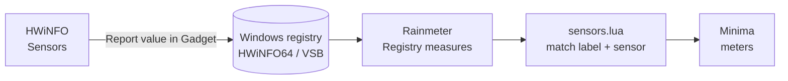

  

  
  
  
  
  

  <b>A quiet system monitor for your desktop.</b> 
  CPU · RAM · GPU · Storage — set in type, not chrome.

  

<!-- Add your real screenshot / GIFs here once recorded:

  
  
  

-->

## About

Minima shows what your machine is doing and nothing else. No cards, no borders, no icons. Large numbers set in light, generously spaced type; thin hairline bars carry the rest. It borrows its visual language from the editorial minimalism of the [Mond](https://github.com/rmskins/mond) skin by ApexXx-SenSei (monochrome palette, airy spacing, one signature display face) and applies it to hardware monitoring.

It is built for laptops as much as desktops: on machines with both an integrated and a discrete GPU, Minima shows **whichever GPU is actually working** and marks it with a small orange indicator.

## Features

- **Four calm rows:** CPU, RAM, GPU and Storage, each with usage, a detail line and a hairline bar.
- **Real temperatures:** CPU and GPU temperature straight from HWiNFO.
- **iGPU / dGPU aware:** shows the active GPU's load and temperature; an orange `iGPU` / `dGPU` tag says which one it is.
- **Resizable:** scroll over the widget or use the right-click menu (0.6x to 2.5x). Size is remembered.
- **Themeable:** colors, fonts, labels and layout are plain variables in one file.
- **No third-party plugins:** only Rainmeter built-ins and a small Lua script.

## Requirements

| Requirement | Why | Get it |
|---|---|---|
| **Rainmeter 4.5+** | The skin engine | [rainmeter.net](https://www.rainmeter.net/) |
| **HWiNFO** (free) | Temperatures and GPU load | [hwinfo.com](https://www.hwinfo.com/) · [download](https://www.hwinfo.com/download/) |
| **Quicksand** (optional) | Body font | [Google Fonts](https://fonts.google.com/specimen/Quicksand) |
| **Anurati** (optional) | Title font | <!-- TODO: add the download link you used, after checking its license --> search for "Anurati font" |

Windows only (a Rainmeter limitation). If a font is missing, Windows substitutes a system font and everything still works.

## Installation

### 1. Install the prerequisites
Install [Rainmeter](https://www.rainmeter.net/) and [HWiNFO](https://www.hwinfo.com/download/). Optionally install the two fonts (right-click the font file, then **Install**).

### 2. Install Minima
Download `Minima_x.y.z.rmskin` from the [latest release](https://github.com/cocserverman/minima-rainmeter/releases/latest) and double-click it. Rainmeter installs and loads the skin.

Manual install

Copy `Skins/Minima` into `Documents\Rainmeter\Skins\`, then in Rainmeter choose **Refresh all** and load `Minima\Minima.ini`.

### 3. Tell HWiNFO what to share
Minima reads sensors that HWiNFO publishes to the Windows registry.

1. Start **HWiNFO64** and choose **Sensors-only**, then **Run**.
2. In the Sensors window, right-click each reading below and choose **Report value in Gadget**:

| Reading (label) | Sensor group | Used for |
|---|---|---|
| `CPU Package` | CPU [#0]: … : DTS | CPU temperature |
| `GPU Total Usage` | iGPU [#0]: Intel … | iGPU load |
| `GPU Core Temperature` | iGPU [#0]: Intel … | iGPU temperature |
| `GPU Core Load` | dGPU [#1]: NVIDIA … | dGPU load |
| `GPU Temperature` | dGPU [#1]: NVIDIA … | dGPU temperature |

Only flag what your machine has. A single-GPU desktop needs just that GPU's two readings. Other hardware may use different labels; see [Hardware notes](#hardware-notes).

3. Check it worked: in `regedit`, open `HKEY_CURRENT_USER\Software\HWiNFO64\VSB`. You should see `Label0`, `Sensor0`, `Value0`, and so on.
4. In HWiNFO's sensor settings, enable starting with Windows and minimizing the Sensors window on startup (names vary slightly by version). Minima only shows values while HWiNFO is running.

### 4. Load the skin
**Manage Rainmeter → Skins → Minima → Minima.ini → Load.** In Rainmeter, **Refresh all** after changing any setting.

## Using Minima

| Action | How |
|---|---|
| Move | Drag the widget |
| Resize | Scroll wheel over the widget (5 % steps), or right-click for presets: Small, Medium, Large, XL, XXL |
| Which GPU is active? | The orange tag in the GPU row: `iGPU` or `dGPU` |

The dGPU counts as "in use" when it is awake and at or above `GpuThreshold` percent load. Otherwise Minima shows the iGPU. A sleeping dGPU reports 0 °C, which Minima displays as `--`.

> Rainmeter has no drag-to-resize for skins, which is why resizing uses the wheel and the menu.

## Configuration

Everything lives in `@Resources\Variables.inc` (edit, save, then **Refresh all**).

| Variable | Default | What it does |
|---|---|---|
| `Scale` | `1` | Overall size. Set by scrolling, editable by hand (0.6 to 2.5) |
| `Drive` | `C:` | Drive shown in the Storage row |
| `HwCpuTempLabel` | `CPU Package\|Core Max` | CPU temperature label(s), first match wins |
| `HwGpuLoadLabel` | `GPU Core Load\|GPU Total Usage\|…` | GPU load label(s) |
| `HwGpuTempLabel` | `GPU Temperature\|GPU Core Temperature` | GPU temperature label(s) |
| `HwIGpuSensor` | `iGPU\|Intel UHD\|Intel Iris\|Intel Xe\|Intel HD` | Sensor-name text that identifies the iGPU |
| `HwDGpuSensor` | `dGPU\|NVIDIA` | Sensor-name text that identifies the dGPU |
| `GpuThreshold` | `5` | dGPU load (%) at which it counts as in use |
| `HwSlots` | `10` | How many flagged HWiNFO readings are scanned |
| `FontTitle` / `FontBody` | `Anurati` / `Quicksand` | Fonts |
| `ColText` … `ColAccent` | monochrome + `FF6A00` | Colors |
| `ColBg` | `0,0,0,1` | Panel behind the skin (try `16,16,16,170`) |

## Hardware notes

Developed and tested on an **Intel Core i7-11850H + Intel UHD Graphics + NVIDIA T1200 Laptop** system. HWiNFO labels vary by hardware, so other setups may need a small tweak in `Variables.inc`:

| Hardware | Temperature label | Load label |
|---|---|---|
| Intel CPU | `CPU Package` | n/a |
| NVIDIA GPU | `GPU Temperature` | `GPU Core Load` |
| Intel iGPU | `GPU Core Temperature` | `GPU Total Usage` |
| AMD CPU | `CPU (Tctl/Tdie)` *(unverified)* | n/a |
| AMD GPU | `GPU Temperature` *(unverified)* | `GPU Utilization` *(unverified)* |

For AMD GPUs, also add a matching word (for example `Radeon`) to `HwIGpuSensor` or `HwDGpuSensor`. **Got a setup that needs different labels? A pull request adding a row to this table is very welcome.**

## Troubleshooting

Set `Hidden=0` on `[mtDebug]` at the bottom of `Minima.ini` and refresh. It prints every HWiNFO slot (label, sensor, value) plus the raw GPU readings.

| Symptom | Likely cause and fix |
|---|---|
| Everything shows `--` | HWiNFO isn't running, or no readings are flagged. Check the registry key above. |
| One value shows `--` | Its label doesn't match. Compare it with the debug output and edit the label variable. |
| GPU temperature `--` on a laptop | Normal while the dGPU sleeps (it reports 0 °C). |
| Tag flips between iGPU and dGPU | Raise `GpuThreshold` to 8–10. |
| Fonts look generic | Install Anurati and Quicksand, then **Refresh all**. |
| Resize does nothing | Scroll with the cursor over the widget; the skin must be able to write `Variables.inc`. |

## How it works

Each flagged HWiNFO reading becomes a `Label / Sensor / Value` triple in the registry. A small Lua script finds the reading you want by label, filters by sensor name (so the iGPU and dGPU can share labels), and hands clean numbers to the meters.

## Credits

- Visual language inspired by **Mond** by ApexXx-SenSei. Minima is an independent skin and contains no Mond code or assets.
- Sensor data by [HWiNFO](https://www.hwinfo.com/); skin engine by [Rainmeter](https://www.rainmeter.net/).
- Fonts: Quicksand (SIL OFL) and Anurati are **not** bundled; install them from their authors.

## License

[MIT](LICENSE) © ARIMANIUS
